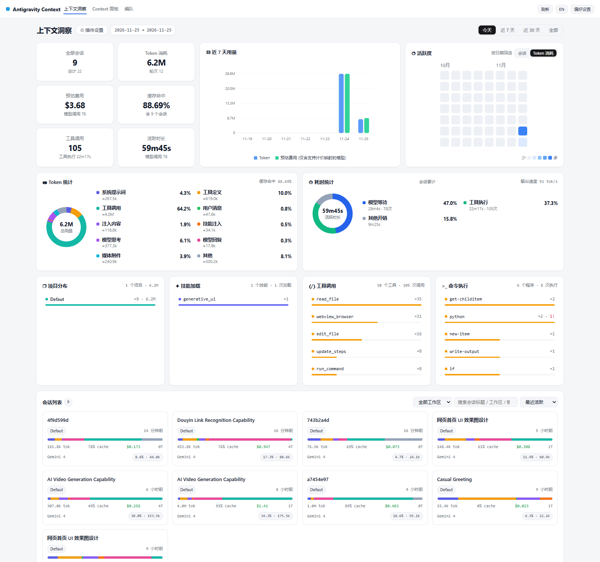
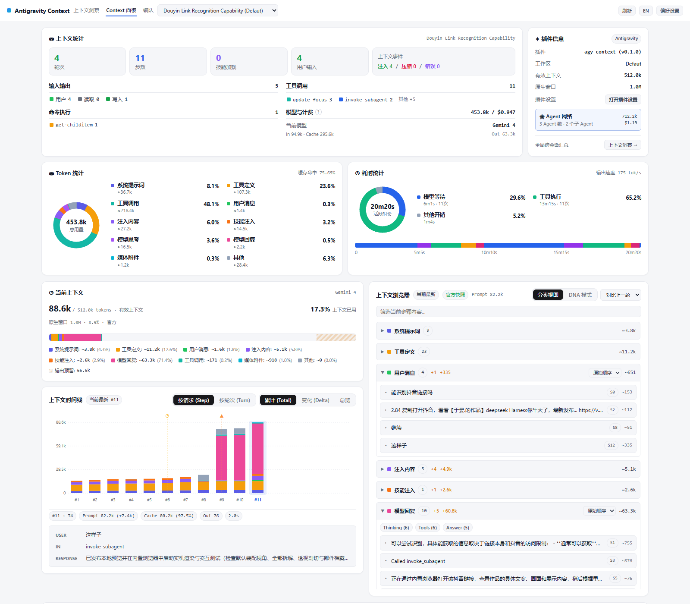
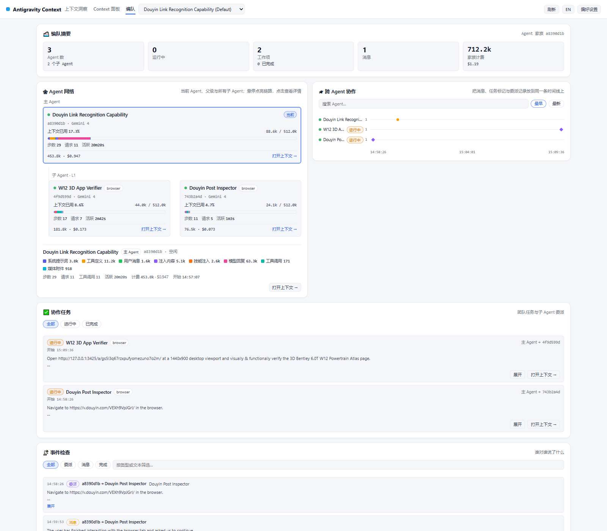
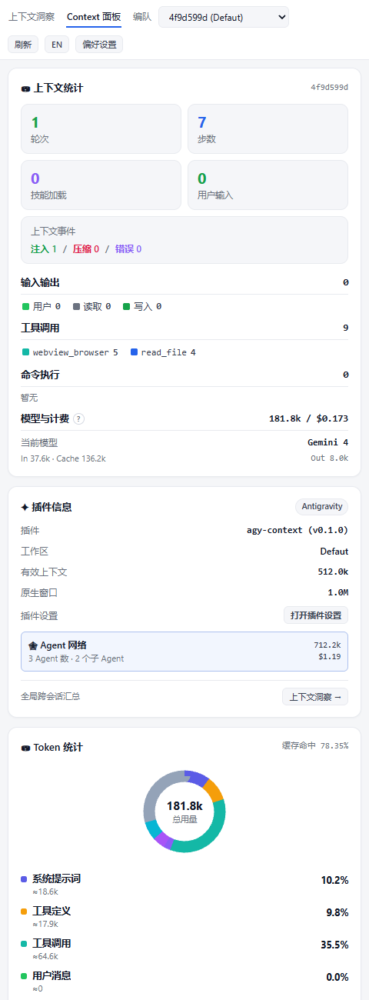

# Antigravity Context

**中文** · [English](README.en.md)

为 Google Antigravity 打造的上下文洞察插件。把每一次请求的上下文组成、Token 消耗、时间线演化、文件与命令活动，以及多 Agent 编队，集中展示在同一个面板里。

- 零第三方依赖、零构建步骤，直接运行在 Antigravity 内置的 Node.js 运行时上
- 中英双语一键切换，自动跟随 Antigravity 深色 / 浅色 / 高对比度主题
- 数据全部来自本机的 `~/.gemini/antigravity`，不联网、不上传
- 衍生自 [dsh-context](https://github.com/bowenliang123/dsh-context)（Apache-2.0，见 [NOTICE](NOTICE)）



## 目录

- [功能](#功能)
- [截图](#截图)
- [安装](#安装)
- [使用](#使用)
- [与 dsh-context 对比](#与-dsh-context-对比)
- [已知限制](#已知限制)
- [工作原理](#工作原理)
- [目录结构](#目录结构)
- [开发与测试](#开发与测试)
- [常见问题](#常见问题)
- [许可证](#许可证)

## 功能

### 1. 上下文洞察（左侧 `Context Insights` 全宽页 / 右侧面板同名标签）

- **KPI 栏**：总计费 Token、预估成本、加权缓存命中率、活跃会话与轮次数、工具执行数、活跃时长。
- **7 天用量与成本**：按每次请求的实际时间归因，成对柱状图展示每日 Token 与费用。
- **8 周热力图**：近 56 天每日用量密度，点击任意日期筛选当天会话。
- **排行**：技能加载（`SKILL.md`）、工具调用、命令执行程序分布，点击条目反向筛选会话。
- **计费组成环形图**：系统提示词 / 工具定义 / 工具调用 / 用户消息 / 注入内容 / 技能注入 / 模型思考 / 模型回复 / 媒体附件 / 其他。
- **会话卡片**：按最近活跃 / Token / 上下文大小 / 成本排序，支持工作区与关键词筛选，点击直达该会话的 Context 仪表板。

### 2. Context 面板（右侧辅助面板，默认页）

- **会话级隔离**：读取宿主注入的 `conversationId`，不同会话各自显示 Token、上下文、时间线与事件；6 秒轮询只在宿主会话真正变化时切换，不覆盖手动选择。
- **Stats 三卡**：Context Stats（轮次 / 步数 / 技能 / 输入输出 / 工具 / 命令 / 计费，带参考单价提示与跳转胶囊）、Token Stats（计费总量 + 分类占比 + 缓存命中率，工具定义与工具调用分列）、Timing Stats（模型等待 / 工具执行 / 其他开销）。
- **当前上下文**：优先读取 Antigravity 语言服务官方快照，同时显示有效窗口（如 512k）与原生窗口（如 1M）双基准、真实占用比例，以及系统提示词、工具定义、用户消息、注入内容、技能注入、模型回复、工具调用、媒体、输出预留的组成条。
- **上下文时间线**：`Step / Turn` 粒度 × `Total / Delta / 总览` 模式，事件旗标（压缩、技能、切模型、错误、最慢、最大增长），悬停联动浏览器，附 `User / In / Response` 三行步骤摘要。
- **上下文浏览器**：可折叠分类、分类内按原始顺序 / 大小 / 名称 / 步骤排序（工具定义另有按调用次数）、`vs Prev Turn / vs Prev Step` 差异徽标、`Thinking / Tools / Answer` 筛选、`Raw / Markdown` 切换、工具返回图片与附件缩略卡，以及按模型读取顺序绘制的 **DNA 色带**。
- **事件、文件、命令**：注入 / 压缩 / 技能 / 切模型 / 错误事件流；按 Read / Written / Searched / Images 筛选的文件活动与增删行估算；程序分布、最慢 / 失败命令与命令执行流，均可跳转到对应步骤。

### 3. 编队（Fleet）

- **编队摘要**：Agent 数、运行中、工作项、消息数、家族计费 Token 与预估成本。
- **Agent 网络**：当前 Agent、父级与全部子 Agent 各一张实时卡片（类型 / 模型 / 上下文占用 / 组成条 / 步数 / 请求 / 活跃时长 / 计费），悬停点亮整条谱系，点击卡片查看详情或直接打开该会话。
- **跨 Agent 协作**：按 Agent 分泳道的统一时间线，叠加委派、消息与完成标记，支持泳道搜索与早期 / 最新切换。
- **协作任务**：把每次子 Agent 委派呈现为任务卡，含状态筛选、任务简报、开始 / 完成时间与最终回报。
- **事件检查**：委派、消息、完成事件汇入同一可筛选事件流，展示发送方 → 接收方与完整记录。

## 截图

| Context 面板 | 编队 |
| --- | --- |
|  |  |

<p align="center">
  
</p>

## 安装

### 前置条件

- 已安装 Antigravity App，并至少完成过一次对话（插件读取 `~/.gemini/antigravity` 下的会话记录）
- 平台：Windows / macOS / Linux；本仓库在 **Windows + Antigravity App** 上实测，其他平台可手动复制安装但未验证

### 一键安装（Windows）

```powershell
git clone https://github.com/answer-mjh/agy-context.git
cd agy-context
powershell -ExecutionPolicy Bypass -File .\scripts\install-plugin.ps1
```

默认安装到 `%USERPROFILE%\.gemini\config\plugins\agy-context`，可用 `-TargetDir` 覆盖。

### 手动安装（macOS / Linux）

```bash
git clone https://github.com/answer-mjh/agy-context.git
mkdir -p ~/.gemini/config/plugins
cp -R agy-context ~/.gemini/config/plugins/agy-context
```

### 启用

1. 打开 Antigravity **Customizations → agy-context**。
2. 启用插件，并开启 **Antigravity Context** sidecar。
3. 打开面板：
   - 左侧边栏 **Plugins → Context Insights**：全宽洞察页（跨会话汇总）
   - 右侧面板 **`+` → Context**：当前会话仪表板

## 使用

- **看当前会话花了多少上下文**：打开右侧 `Context 面板`。`Token 统计` 是计费口径，`当前上下文` 是官方快照口径（有效窗口 vs 原生窗口）。
- **找是谁吃掉了上下文**：在 `上下文浏览器` 展开分类并按大小排序；`模型回复` 里再用 `Tools / Thinking / Answer` 筛选。切到 `对比上一轮` 会显示有符号差异。
- **看上下文怎么涨起来的**：切到 `上下文时间线` 的 `变化 (Delta)`，图表会标出压缩、切模型、最慢与最大增长。
- **看跨会话消耗与排行**：左侧 `Context Insights`，按日期 / 工作区筛选，点会话卡回到单会话视图。
- **看多 Agent 协作**：`编队` 标签页查看父子谱系、泳道时间线与任务回报。
- 面板右上角：刷新、`EN / 中文` 切换、偏好设置（范围、趋势粒度与模式、浏览器基线、编队标签显隐）。

## 与 dsh-context 对比

参考实现：[dsh-context](https://github.com/bowenliang123/dsh-context) 0.87（DeepSeek Harness 插件）。逐项说明见 [docs/parity-with-dsh-context.md](docs/parity-with-dsh-context.md)。

| 能力 | dsh-context | agy-context |
| --- | :---: | :---: |
| 跨会话洞察（KPI / 7 天图 / 热力图 / 排行 / 会话卡） | ✅ | ✅ |
| 单会话 Context 仪表板（Stats / Token / Timing） | ✅ | ✅ |
| 官方上下文快照 + 双窗口基准 | ✅ | ✅（语言服务可用时） |
| 时间线 Step/Turn × Total/Delta/Overview | ✅ | ✅ |
| 上下文浏览器 / DNA / 差异徽标 | ✅ | ✅ |
| 事件 / 文件活动 / 命令执行 | ✅ | ✅ |
| 多 Agent 编队与协作时间线 | ✅ | ✅（基于会话元数据推断） |
| 一键跳回指定对话 | ✅ | ❌ 宿主无稳定 API |
| Pin / Lock to Main Agent | ✅ | ❌ 依赖宿主扩展 API |
| `/context` 斜杠命令 | ✅ | ❌ 斜杠列表由宿主固定 |
| 系统提示词前缀 / 后缀 | ✅ | ❌ 插件无法改写宿主提示词 |
| 附件内置预览（PDF / Office） | ✅ | ⚠️ 仅图片缩略图 |

## 已知限制

- **没有“对话”跳转**：sidecar 只能开关面板，无法稳定打开指定会话，因此移除了该入口。
- **左右两页口径略有差异**：左侧洞察页的分类来自投影缓存，`toolDefs` 记为 0；单会话 Context 页使用官方快照精确拆分，两页数值可能相差约 9%，属数据源差异而非重复计数。
- **子 Agent 归属是推断值**：依据 `conversation_summaries` 的 `agent_name / parent_conversation_id / nesting_depth` 与 `transcript.jsonl` 里的 `invoke_subagent` / `send_message`，不是宿主权威数据，缺少 blocked-by 依赖链。
- **编队首屏较慢**：首次需要解析家族成员的完整 transcript，成员多时约数秒，之后命中 LRU / 投影缓存。
- **语言服务不可用时回退估算**：缺少 `ANTIGRAVITY_LS_ADDRESS`（如 `--standalone-port` 调试模式）时没有官方快照，窗口退化为估算值，工具定义无法独立拆出。
- **附件只支持图片**：宿主只提供 `/api/attachment` 图片接口，其他文件仅显示元数据。

## 工作原理

- **L1 元数据**：只读 `~/.gemini/antigravity/conversation_summaries.db`（`node:sqlite`，不可用时降级为目录扫描）。
- **L2 增量投影缓存**：按 `transcript.jsonl` 的 `mtimeMs + size` 增量更新精简摘要，缓存到 `${ANTIGRAVITY_EXECUTABLE_DATA_DIR}`。
- **L3 按需明细**：打开单步浏览器时流式解析 `transcript_full.jsonl`，LRU 缓存最近 4 个会话。
- **官方上下文快照**：通过 sidecar 注入的 `ANTIGRAVITY_LS_ADDRESS` / `ANTIGRAVITY_CSRF_TOKEN` 调用 `GetCascadeTrajectoryGeneratorMetadata`，读取 `estimatedTokensUsed`、`maxContextTokens`、`tokenBreakdown.groups`、`promptSections` 与工具定义；失败则回退 transcript 估算。
- **系统提示词与工具定义**：`system_base` 逐条展示官方 `promptSections`；`tool_defs` 展示工具的完整描述与 JSON Schema，并按 `MCP` / `Antigravity` / `native` / `raw` 标注来源。
- **压缩检查点**：识别 `CHECKPOINT` 步骤，重置累计上下文、把摘要计入新上下文，并单独记录压缩事件与计费。

## 目录结构

```
agy-context/
├─ plugin.json                  # 插件清单（名称、版本、图标、建议提示词）
├─ sidecars/
│  └─ context_panel/
│     ├─ main.mjs               # 入口：sidecar 模式 / standalone 调试模式
│     ├─ sidecar.json           # 视图注册（AUX_PANE + SIDEBAR）
│     ├─ lib/                   # 数据层：env、projection、session、fleet、router…
│     └─ web/                   # 前端：无构建的原生 JS + CSS（views / charts / i18n）
├─ skills/agy-context/SKILL.md  # 让 Agent 一键打开面板的 skill
├─ scripts/install-plugin.ps1   # Windows 安装脚本
├─ tests/verify.mjs             # 后端接口自检
└─ docs/                        # 截图与对比文档
```

## 开发与测试

```bash
# 独立调试（不需要 Antigravity；没有语言服务，官方快照会回退为估算）
node sidecars/context_panel/main.mjs --standalone-port 17846

# 后端自检：健康检查、洞察、单会话、步骤浏览器、编队、偏好设置
node tests/verify.mjs
```

环境变量：

| 变量 | 用途 |
| --- | --- |
| `ANTIGRAVITY_SIDECAR_WEB_PORT` | sidecar 模式端口（宿主注入） |
| `ANTIGRAVITY_LS_ADDRESS` / `ANTIGRAVITY_CSRF_TOKEN` | 语言服务地址与令牌（官方快照） |
| `ANTIGRAVITY_EXECUTABLE_DATA_DIR` | 缓存目录 |

## 常见问题

**为什么没有 `/context` 命令？**
Antigravity 的斜杠命令列表由宿主固定注册，插件无法追加。可用 `skills/agy-context/SKILL.md` 或插件的建议提示词一键打开面板。

**左侧和右侧的数字为什么不一样？**
左侧是跨会话投影口径，右侧当前会话是官方快照 + 明细口径。要看单会话精确拆分，以右侧 `Context 面板` 为准。

**会上传我的对话吗？**
不会。插件只读取本机会话文件，不发起网络请求。

**升级后界面没变？**
`scripts/install-plugin.ps1` 只会复制 `plugin.json / README*.md / LICENSE / NOTICE / assets / docs / skills / sidecars`；复制后在 Customizations 里重载插件或重启 Antigravity，再刷新面板。

## 致谢

- [dsh-context](https://github.com/bowenliang123/dsh-context)：交互与信息架构的参考实现
- Antigravity App 提供的 sidecar 与语言服务接口

本项目与 Google、DeepSeek 及 dsh-context 作者无隶属关系。

## 许可证

[Apache-2.0](LICENSE)。

本项目是 [dsh-context](https://github.com/bowenliang123/dsh-context)（Copyright 2025 bowenliang123，Apache-2.0）的衍生作品：沿用了其上下文洞察的功能设计与界面信息架构，改写为 Antigravity sidecar 运行时下的零构建实现。修改内容见 [NOTICE](NOTICE)，逐项功能差异见 [docs/parity-with-dsh-context.md](docs/parity-with-dsh-context.md)。
